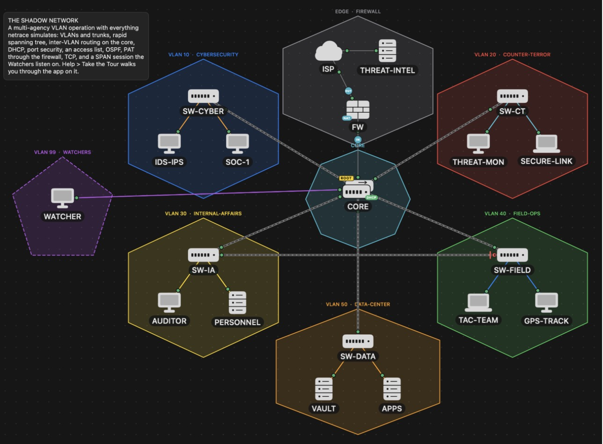
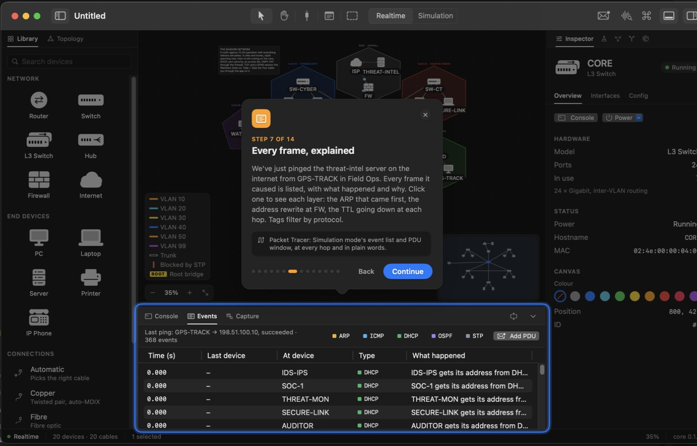
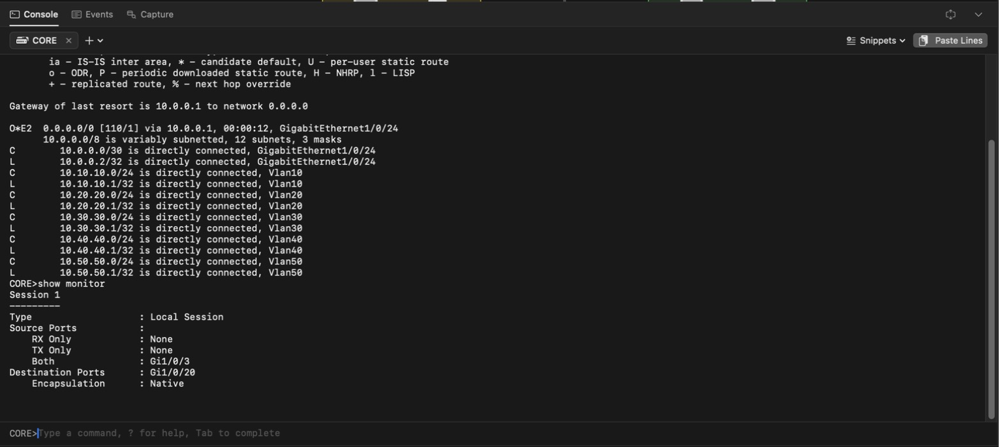
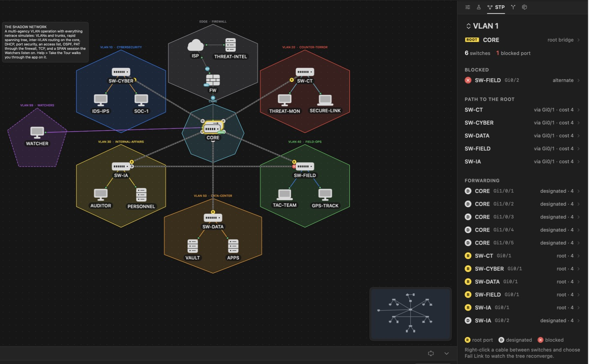
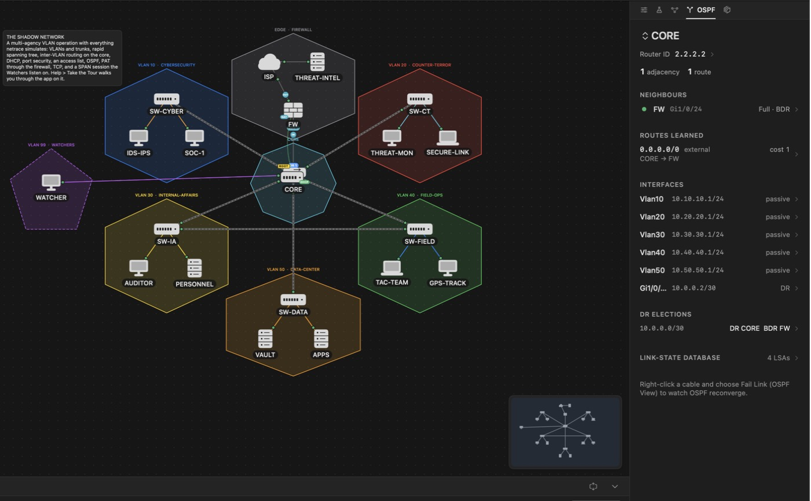
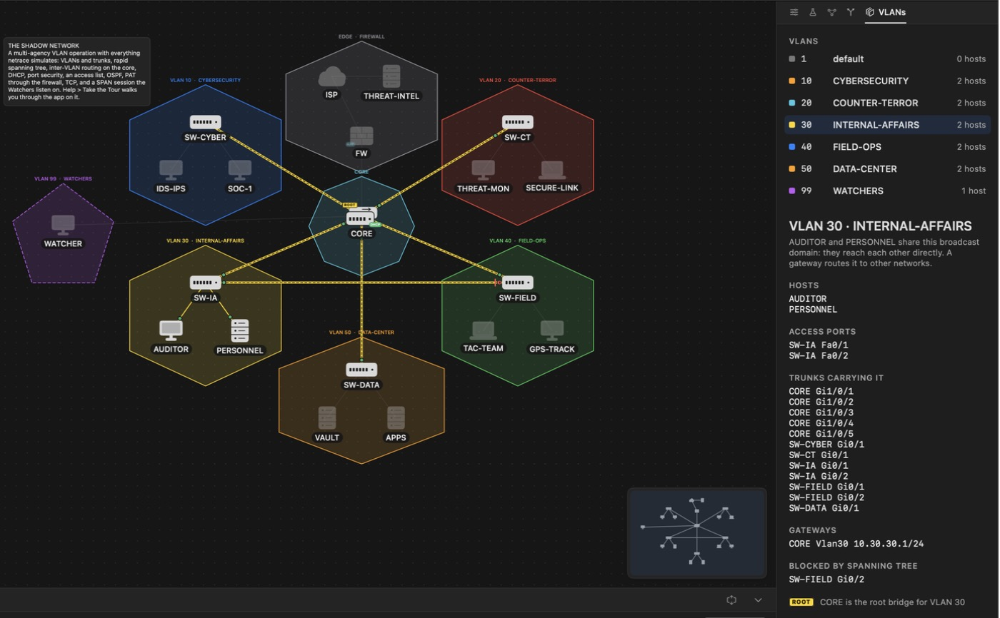
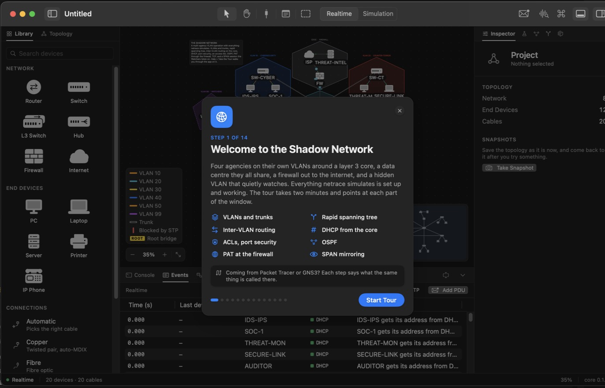

<div align="center">

# netrace

**The CCNA network simulator that explains itself.**<br>
Build a network, send a packet, and see every hop, with the reason it happened.

Native macOS app · Rust simulation core · No images, no VMs, no accounts

</div>

<p align="center">
  
</p>

<p align="center"><sub>The bundled <b>Shadow Network</b>: 20 devices, every feature below already configured and working.</sub></p>

## Why netrace

| | Packet Tracer / GNS3 | netrace |
|---|---|---|
| Why did my ping fail? | Read the config, guess | The trace says: *"CORE would route it out Gi1/0/24, but doesn't know FW's MAC yet, so it drops this packet and asks with ARP."* |
| Setup | Account, images or VMs | Open the app |
| Spanning tree, OSPF | `show` commands on every device | One live view of the whole network |
| Checking your work | Mostly the configuration you typed | Checks the **behaviour**: "can PC1 ping PC2?" |
| Wireshark | Separate tool | Capture any cable, export `.pcap` |

## For students

**Every packet explained.** Click any event and read what happened in plain English, layer by layer: ARP before ICMP, the TTL dropping at each router, the address NAT rewrote.

<p align="center">
  
</p>

**A real IOS command line.** Modes, `?` help, Tab completion, abbreviations, `show` commands, the familiar `% Invalid input` errors. PCs get `ping`, `tracert`, `ipconfig`, `curl` and `telnet`.

<p align="center">
  
</p>

**Protocol views, not guesswork.** See which switch is the spanning-tree root and why, which port blocks, who the OSPF DR is, and every route with the path it takes. Fail a cable and watch the network reconverge.

<p align="center">
  
</p>

<p align="center">
  
</p>

**VLANs you can see.** Pick a VLAN and the canvas lights up its hosts, access ports, trunks and gateway.

<p align="center">
  
</p>

## For teachers

- **20 guided CCNA labs**, from your first ping to NAT and OSPF troubleshooting. Each task checks the simulated network live and says what's still missing.
- **Checks look at behaviour**, so any correct answer passes: pings, routes, VLANs, trunks, OSPF neighbours, STP root, DHCP leases, config lines.
- **Lock devices** (ISP, servers) so students can read them but not break them.
- **Write your own labs** as a small JSON section in the `.netrace` file. Format in [LABS.md](LABS.md).
- **Reproducible**: the same network always produces the same trace, so everyone sees the same thing.
- **Snapshots** let students try something risky and roll back.

## For everyone

**Built-in tour.** *Help → Take the Tour* walks through the app in 14 steps on the Shadow Network, and says what each part is called in Packet Tracer and GNS3.

<p align="center">
  
</p>

## What it simulates

| Area | Covered |
|---|---|
| Switching | VLANs, 802.1Q trunks, rapid/PVST spanning tree, port security, CDP/LLDP, SPAN mirroring |
| Routing | Static and default routes, router-on-a-stick, layer 3 switch SVIs, OSPF (multi-area, DR/BDR, default origination) |
| Services | DHCP (router and server, relay), standard and extended ACLs, NAT (static, pool, PAT) |
| Transport | TCP handshake, HTTP `curl`, `telnet`, ports in ACLs and PAT |
| Devices | Router, switch, L3 switch, hub, firewall, internet cloud, PC, laptop, server, printer, IP phone |
| Tools | Snapshots, power on/off, link latency/jitter/loss/bandwidth, per-cable capture, `.pcap` export, undo everywhere |

Command-by-command status is in [COMPATIBILITY.md](COMPATIBILITY.md). Nothing is verified against real IOS yet, and the file says so.

## Try it

Needs macOS 15+, Xcode 26+, [Rust](https://rustup.rs) and XcodeGen (`brew install xcodegen`).

```bash
git clone https://github.com/network-tracer/netrace.git
cd netrace
make run
```

Then **Help → Take the Tour**, or **File → New from Lab…** (⌥⌘N). Sample projects are in `examples/`; open `examples/tour.netrace` for the Shadow Network.

## Not yet

IPv6, EtherChannel, HSRP, wireless, DNS/NTP/Syslog servers, and importing `.pkt` files. The full plan is in [SCOPE.md](SCOPE.md); the interface direction is in [DESIGN.md](DESIGN.md).

## For developers

```bash
make test    # Rust tests
make lint    # rustfmt + clippy
make open    # open the project in Xcode
```

After changing anything in `crates/`, run `make core` before building in Xcode: the app links the static library and Swift bindings that step produces.

## Beta builds

`make beta` runs lint and the tests, then builds an optimised universal
(Apple silicon + Intel) Release app into `dist/netrace-VERSION-beta.zip`.
It's signed ad hoc until there's a Developer ID, so on another Mac the first
launch needs right-click → Open (or System Settings → Privacy & Security →
Open Anyway).

After changing anything in `crates/`, run `make core` before building in Xcode:
the app links the static library and Swift bindings that step produces.

## Layout

```
crates/
  netrace-sim/   deterministic event scheduler, virtual clock, seeded RNG
  netrace-doc/   project model + .netrace file format (JSON, validated on load)
  netrace-engine/ network simulation: VLANs, spanning tree, routing, ARP, ICMP, explained traces
  netrace-cli/   IOS-style command line: modes, parser, help, show output
  netrace-labs/  lab checks on simulated state, and the bundled labs
  netrace-ffi/   UniFFI bridge: the only API the Swift app sees
app/
  project.yml    XcodeGen spec (the .xcodeproj is generated, not committed)
  Netrace/       SwiftUI app: document, canvas, library, inspector, design tokens
  Netrace/Design/          tokens (Theme), device symbols, device catalog, icons, appearance
  Netrace/Workspace/       per-window interface state; per-window state
  Netrace/Views/           Window (toolbar, menus, ⌘K), Sidebar, Canvas, Inspector, BottomPanel
  Netrace/Assets.xcassets/ Icons/*.imageset (SVG source of each icon), AppIcon
design/
  app-icon.svg   app icon source
scripts/
  build-core.sh        Rust → NetraceCore.xcframework + Generated/netrace_ffi.swift
  render-app-icon.sh   design/app-icon.svg → AppIcon.appiconset (needs librsvg)
  make-labs.py         generates labs/ (topologies, tasks, checks, solutions)
labs/            the 20 bundled labs and their solution scripts
examples/        sample projects
```

Generated and git-ignored: `app/Netrace.xcodeproj`, `app/Frameworks/`,
`app/Netrace/Core/Generated/`, `app/Support/Info.plist`, `app/Support/Netrace.entitlements`.

## How the pieces talk

The Swift app owns windows and rendering; the Rust core owns every rule.
Swift calls coarse commands on a `Project` object (`addDevice`, `moveDevice`,
`connect`, …) and redraws from the plain-value `ProjectSnapshot` the core returns.
Every edit registers its inverse with the window's undo manager, which is also
how macOS tracks unsaved changes.

A `.netrace` file is a package (folder) containing `project.json`.

## License

[MIT](LICENSE)
